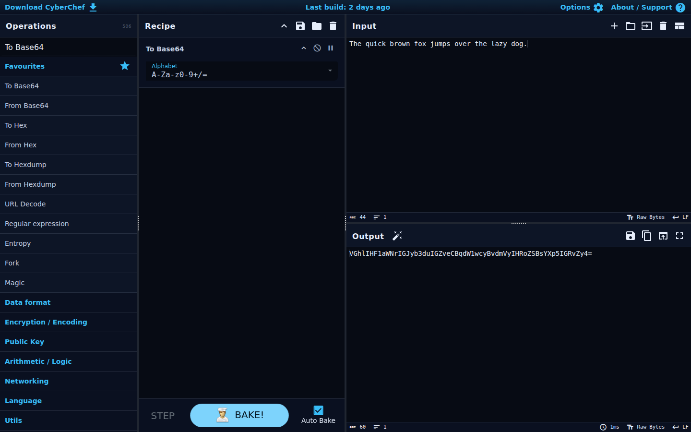
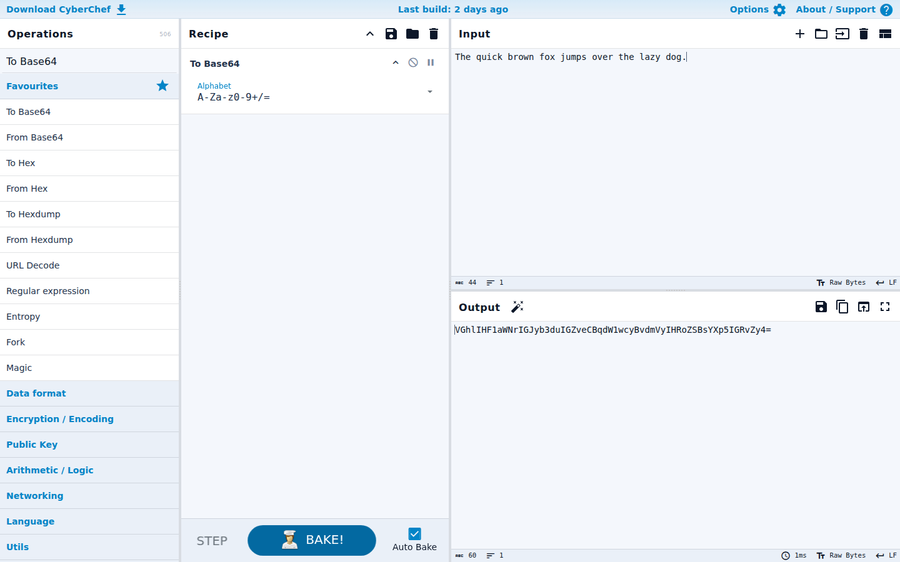

# CyberChef — hardened container

[CyberChef](https://github.com/gchq/CyberChef) v11.6.0 packaged as a small,
hardened, unprivileged nginx container with dark/light defaults, Roger's
control-room branding, runtime configuration and GHCR publishing.

> This is an **unofficial** deployment of CyberChef, not a GCHQ release. The
> application is unchanged apart from theme/bootstrap injection, branding CSS,
> a custom favicon, a same-origin loader image and a resolved download checksum.





## What this repository is

This repository contains the **prebuilt CyberChef v11.6.0 release**, not the
upstream JavaScript source tree:

| Item | Value |
|---|---|
| CyberChef version | `11.6.0` |
| Upstream commit | `f464d62c7c943cda9749a765932a7548ba9bfb16` |
| Release ZIP | `source/CyberChef_f464d62c7c943cda9749a765932a7548ba9bfb16.zip` |
| Entry page | generated from `source/index.html.gz` |
| Upstream project | <https://github.com/gchq/CyberChef> |
| License | Apache-2.0 |

`source/` deliberately keeps only the immutable release ZIP, `index.html.gz`
and a `SHA256SUMS` file. The ZIP contains the assets, modules and standalone
HTML; upstream excludes `index.html` from the ZIP, so the compressed entry page
is stored separately. The Docker build verifies both checksums before use.

### Build system and dependencies

- **No Node/npm build.** CyberChef is already compiled upstream.
- **Docker multi-stage build:**
  - `alpine:3.22` (digest-pinned) with Python 3 and `unzip` verifies and
    prepares the release.
  - `nginxinc/nginx-unprivileged:1.31-alpine` (digest-pinned) serves the
    static files as uid 101. The final stage runs `apk upgrade` to apply fixed
    Alpine packages before the image is scanned.
- **Python scripts** run only during the image build/CI:
  - `scripts/prepare-index.py` injects the runtime hooks and extracts the
    loader SVG.
  - `scripts/csp-hashes.py` hashes the inline bootstrap scripts.
- **Runtime dependencies:** nginx, `envsubst` (included in the nginx image) and
  BusyBox utilities such as `wget` for the health check.
- **CI:** GitHub Actions builds multi-architecture images, publishes to GHCR
  and runs Gitleaks, Hadolint, ShellCheck, a container smoke test and Trivy.

## Why this exists

CyberChef is a static, client-side application. There is no backend, database,
account system or server-side processing. The container's only jobs are to:

1. Serve the immutable static files over HTTP.
2. Set a safe default theme and the Roger palette before CyberChef boots.
3. Apply a strict security-header policy.
4. Accept plain HTTP from HAProxy, which terminates TLS.

Input, recipes, favourites and options stay in the visitor's browser
(`localStorage`). The web server never receives or stores them. CyberChef has
three operations that can contact external services — **HTTP request**, **DNS
over HTTPS** and **Show on map**. The default CSP blocks all three; see
[CSP and blocked network operations](#csp-and-blocked-network-operations).

```
Browser ── HTTPS ──> HAProxy (TLS, optional auth/ACL)
                         │  plain HTTP + X-Forwarded-For
                         ▼
                 nginx-unprivileged :8080
                         │
                         ▼
                 static CyberChef v11.6.0
```

## Quick start

Requirements: Docker Engine and Docker Compose v2.

```bash
cp .env.example .env
# edit .env, at minimum set TRUSTED_PROXY_CIDRS to your HAProxy CIDR
docker compose up -d
```

Open <http://127.0.0.1:8014> (or the host/port you configured). After changing
`.env`, recreate the container so the entrypoint regenerates `config.js`,
`brand.css` and the nginx configuration:

```bash
docker compose up -d --force-recreate
```

Copy-paste examples for a minimal `.env`, a minimal Compose file and a raw
`docker run` command are in [docs/EXAMPLES.md](docs/EXAMPLES.md). The canonical
files in this repository are:

| File | Purpose |
|---|---|
| [`Dockerfile`](Dockerfile) | Image build. |
| [`compose.yaml`](compose.yaml) | Hardened Compose deployment. |
| [`.env.example`](.env.example) | Complete environment template. |
| [`docs/EXAMPLES.md`](docs/EXAMPLES.md) | Minimal env, Compose and Docker examples. |

The image is pulled from:

```text
ghcr.io/rogerbergling/cyberchef:latest
```

If the package is private, authenticate first:

```bash
echo "$CR_PAT" | docker login ghcr.io -u YOUR_GITHUB_USERNAME --password-stdin
```

To build locally instead:

```bash
docker build -t ghcr.io/rogerbergling/cyberchef:local .
IMAGE_TAG=local docker compose up -d
```

Health check:

```bash
curl -fsS http://127.0.0.1:8014/healthz
```

## Configuration

All runtime settings are environment variables. Compose reads `.env`
automatically; `.env.example` documents every option with its default. Only
`.env.example` is committed; `.env` is ignored by Git. Quote
values that contain `#`, spaces or parentheses (for example colours and CSP
values) as shown in `.env.example`. The entrypoint validates values and fails
closed rather than starting with a broken or unsafe configuration.

### Container and publishing

| Variable | Default | Description |
|---|---|---|
| `IMAGE_TAG` | `latest` | Image tag to run (Compose only). For digest pinning, edit the `image:` line in `compose.yaml`. |
| `BIND_ADDRESS` | `0.0.0.0` | Host address to publish on (Compose only). |
| `HOST_PORT` | `8014` | Host port HAProxy connects to (Compose only). |
| `APP_PORT` | `8080` | nginx listen port inside the container. Must be 1024–65535. |

### Application and theme

| Variable | Default | Description |
|---|---|---|
| `APP_THEME` | `dark` | Default theme for first-time visitors. Values: `dark`, `light`, `classic`, `geocities`, `solarized-dark`, `solarized-light`. `light`, `white` and `classic` all map to CyberChef Classic. |
| `APP_TITLE` | `CyberChef` | Base browser tab title. CyberChef still prefixes the active recipe, e.g. `To Base64 - CyberChef`. Printable ASCII only. |
| `APP_FAVICON` | `favicon.svg` | Local relative favicon path shipped in the image (SVG or PNG). |
| `SERVER_NAME` | `_` | nginx `server_name`; `_` is the catch-all. |
| `TRUSTED_PROXY_CIDRS` | `192.168.0.0/18` | Comma-separated CIDRs allowed to set `X-Forwarded-For`. Empty disables real-IP handling. |
| `REAL_IP_HEADER` | `X-Forwarded-For` | Header used for the real client IP. |

#### Theme behaviour

```dotenv
APP_THEME=dark    # default
# APP_THEME=light # white mode (CyberChef Classic)
```

`APP_THEME` is the **default**, not a forced theme. On the first visit,
`config.js` writes the default into CyberChef's `options` entry in browser
`localStorage`. A visitor can change the theme in **Options → Theme** and that
choice persists for that browser. Changing `APP_THEME` later affects only
visitors who have not yet chosen a theme. To return to the server default,
clear the site's local storage and reload. CyberChef's **Reset options to
default** button restores its own upstream defaults (Classic), not the server
default.

### nginx runtime

| Variable | Default | Description |
|---|---|---|
| `LOG_LEVEL` | `warn` | nginx error-log level. |
| `ACCESS_LOG` | `on` | `on` writes access logs to stdout; `off` disables them. |
| `NGINX_WORKER_PROCESSES` | `2` | Fixed worker count, or `auto` to follow the CPU count. |
| `NGINX_WORKER_CONNECTIONS` | `1024` | Connections per worker. |
| `KEEPALIVE_TIMEOUT` | `30s` | HTTP keep-alive timeout. |
| `CLIENT_MAX_BODY_SIZE` | `1m` | Request body limit. CyberChef uploads are client-side; no large POSTs are needed. |
| `GZIP` | `on` | Dynamic gzip. Precompressed `.gz` assets are used when available. |
| `GZIP_COMP_LEVEL` | `5` | 1–9. |
| `CACHE_HTML` | `-1` | nginx `expires` value for HTML (`-1` = no-cache). |
| `CACHE_ASSETS` | `-1` | Expiry for JS/CSS. Keep no-cache so a new image cannot be mixed with an old bundle. |
| `CACHE_MEDIA` | `7d` | Expiry for images, fonts and the favicon. |
| `CACHE_DOWNLOAD` | `1h` | Expiry for the release ZIP. |

### Security headers

| Variable | Default |
|---|---|
| `CSP_DEFAULT_SRC` | `'self'` |
| `CSP_SCRIPT_SRC` | Generated at build time: `'self' 'wasm-unsafe-eval'` plus the hashes of CyberChef's inline bootstrap scripts. |
| `CSP_STYLE_SRC` | `'self' 'unsafe-inline'` |
| `CSP_IMG_SRC` | `'self' data: blob:` |
| `CSP_FONT_SRC` | `'self' data:` |
| `CSP_CONNECT_SRC` | `'self' blob:` |
| `CSP_MEDIA_SRC` | `'self' data: blob:` |
| `CSP_WORKER_SRC` | `'self' blob:` |
| `CSP_CHILD_SRC` | `'self' blob:` |
| `CSP_FRAME_SRC` | `'none'` |
| `CSP_OBJECT_SRC` | `'none'` (the loader is a plain image) |
| `CSP_BASE_URI` | `'none'` |
| `CSP_FORM_ACTION` | `'none'` |
| `CSP_FRAME_ANCESTORS` | `'none'` |
| `CSP_MANIFEST_SRC` | `'self'` |
| `PERMISSIONS_POLICY` | Restrictive list; see `.env.example`. Clipboard and fullscreen are left at their default self allowlist. |

The generated CSP is built only from these variables. Values containing double
quotes, backslashes or `$` are rejected to prevent nginx-config injection.

### Branding

The branding stylesheet is generated at container start from validated hex
colours. The layout remains upstream CyberChef; only colours, typography and
accents change.

| Variable | Default |
|---|---|
| `BRAND_BG` | `#070b14` |
| `BRAND_BG_SOFT` | `#0a1020` |
| `BRAND_BG_ELEV` | `#0d1526` |
| `BRAND_LINE` | `rgba(148, 163, 184, 0.18)` |
| `BRAND_LINE_STRONG` | `rgba(148, 163, 184, 0.34)` |
| `BRAND_TEXT` | `#e7eefb` |
| `BRAND_TEXT_SOFT` | `#c2cee2` |
| `BRAND_MUTED` | `#93a3bb` |
| `BRAND_ACCENT` | `#38bdf8` |
| `BRAND_ACCENT_2` | `#a78bfa` |
| `BRAND_OK` | `#34d399` |
| `BRAND_WARN` | `#fbbf24` |
| `BRAND_DANGER` | `#f87171` |

The light theme uses a matching light palette. Novelty themes (`geocities`,
`solarized-*`) keep their upstream appearance.

## HAProxy and TLS

The container speaks **plain HTTP**; TLS must be terminated by HAProxy. Do not
add SSL certificates to this repository or Compose file. Serve CyberChef at the
root of a dedicated hostname (for example `cyberchef.example.net`); subpath
deployment is not tested.

Minimal HAProxy backend (HAProxy on the Docker host, app published on
`0.0.0.0:8014`):

```haproxy
backend cyberchef
    option forwardfor
    option httpchk GET /healthz
    http-check expect status 200
    server cyberchef 127.0.0.1:8014 check

frontend https_in
    bind *:443 ssl crt /etc/haproxy/certs/cyberchef.pem alpn h2,http/1.1
    # Enable HSTS only after HTTPS works for every hostname you serve.
    http-response set-header Strict-Transport-Security "max-age=31536000; includeSubDomains"
    default_backend cyberchef
```

If HAProxy is itself a container, `127.0.0.1` points at HAProxy, not the host.
Use the Docker host gateway address (often `172.17.0.1`) or put both containers
on a dedicated Docker network and connect directly to `cyberchef:8080`.

### Trusted proxy addresses

`TRUSTED_PROXY_CIDRS` controls which peers may set `X-Forwarded-For`. Set it to
the **source address HAProxy appears as** to nginx:

- HAProxy on the LAN: `192.168.0.0/18` (the default).
- HAProxy container on a Docker bridge: add that bridge/network, for example
  `192.168.0.0/18,172.16.0.0/12`.
- Unknown or direct exposure: set it empty. Logs will show the proxy address,
  and no client can spoof `X-Forwarded-For`.

Because Compose publishes on `0.0.0.0` by default, restrict port `8014` with a
host firewall so only HAProxy can reach it. Better still, bind
`BIND_ADDRESS=127.0.0.1` when HAProxy runs on the host.

## Security

### Container controls

- Runs as **uid 101**, never root.
- Read-only root filesystem; `/tmp` is a size-limited `tmpfs` with `noexec` and
  `nosuid`.
- All Linux capabilities dropped.
- `no-new-privileges`.
- PID limit, memory limit and bounded JSON log rotation.
- Only GET and HEAD are accepted by the application location.
- Dotfiles (except `/.well-known/security.txt`), source maps and compressed
  JS/CSS/HTML sidecars are denied.
- nginx tokens are off; directory listing is off.
- Base images are pinned by digest; GitHub Actions are pinned by commit SHA.
- The final image runs `apk upgrade` to apply fixed Alpine packages, then CI
  scans the result with Trivy.
- The build verifies `source/SHA256SUMS`, resolving the upstream download hash.

### HTTP headers

Every response receives:

- Content-Security-Policy (hash-based for inline scripts, no JavaScript
  `unsafe-eval`; WebAssembly-only `'wasm-unsafe-eval'`).
- `X-Content-Type-Options: nosniff`
- `X-Frame-Options: DENY`
- `X-XSS-Protection: 0` (disables the obsolete, buggy legacy filter)
- `Referrer-Policy: no-referrer`
- `Permissions-Policy` (camera, microphone, geolocation, USB, etc. disabled)
- `Cross-Origin-Opener-Policy: same-origin`
- `Cross-Origin-Resource-Policy: same-origin`
- `X-Permitted-Cross-Domain-Policies: none`
- `X-DNS-Prefetch-Control: off`

HSTS is intentionally **not** set here. Set it at HAProxy once HTTPS works.

### CSP and blocked network operations

The default policy is deliberately strict. It **blocks** these CyberChef
operations:

| Operation | Why it is blocked | To enable |
|---|---|---|
| HTTP request | `connect-src 'self' blob:` blocks arbitrary destinations. Allowing `https:` would let a recipe exfiltrate input. | Set `CSP_CONNECT_SRC` to the exact origins you trust. |
| DNS over HTTPS | `connect-src 'self' blob:` blocks Google/Cloudflare resolvers. | `CSP_CONNECT_SRC="'self' blob: https://dns.google.com https://cloudflare-dns.com"` |
| Show on map | `img-src` does not allow Wikimedia tile hosts. | Add the tile host to `CSP_IMG_SRC`. |
| Render HTML scripts | No `unsafe-eval`. Inline event handlers and injected scripts do not run. | Not recommended. |

Local operations, workers, WebAssembly, compression, hashing, crypto and file
handling that do not rely on `eval` or external origins work under the default
policy. The default policy was verified in a headless Chromium run with a real
recipe; CI smoke-tests the served app, generated theme/branding and security
headers.

`CSP_STYLE_SRC` allows inline styles because CyberChef and its UI library set
style attributes dynamically. `'wasm-unsafe-eval'` is allowed so CyberChef's
WebAssembly modules compile; it does **not** enable JavaScript `eval`, inline
scripts or inline event handlers. These are deliberate, lower-risk trade-offs
than allowing inline or eval'd scripts.

### Supply chain

- `source/SHA256SUMS` is checked during every image build.
- The upstream release ZIP and `index.html.gz` are the only application
  artifacts accepted by the build.
- `source/` is not rebuilt from npm at image build time, avoiding a live
  dependency resolution step.
- GHCR publishes `linux/amd64` and `linux/arm64` images with provenance and an
  SBOM.
- CI runs Gitleaks, Hadolint, ShellCheck, Trivy and a hardened-container smoke
  test.

### Privacy and limitations

- No analytics, telemetry, external fonts or third-party scripts. CyberChef
  stores options, favourites and saved recipes in browser `localStorage`.
- No server-side storage of input or recipes.
- CyberChef can put input into the URL fragment when **Update the URL** is
  enabled. Fragments are not sent to the server, but they can enter browser
  history or sync. Disable that option for sensitive work.
- CyberChef is not an authentication boundary. If the deployment must be
  private, add authentication and IP restrictions at HAProxy.
- CyberChef's UI is desktop-first. The upstream layout is not optimised for
  narrow mobile screens; use it on a desktop or wide tablet.
- A browser is the security boundary. A browser or extension compromise is out
  of scope, as are denial-of-service attacks.
- `Render HTML` is intentionally constrained by CSP. Do not relax the CSP for
  untrusted input.

Report vulnerabilities privately; see [SECURITY.md](SECURITY.md). Do not open a
public issue for a security report.

## Publish to GHCR

`.github/workflows/publish.yml` builds and pushes the image on every push to
`main`, every `v*` tag and manual dispatch.

```text
ghcr.io/rogerbergling/cyberchef:latest
ghcr.io/rogerbergling/cyberchef:sha-<commit>
ghcr.io/rogerbergling/cyberchef:v11.6.0   # when tagged
```

The workflow uses `GITHUB_TOKEN` with `packages: write`; no extra secret is
needed. Require the **Security checks** workflow in branch protection before
merging to `main`, so a failed Gitleaks/lint/smoke/Trivy run blocks publishing.
To make the package public: **Packages → cyberchef → Package settings → Change
visibility → Public**.

To pin a reviewed image in production, use the digest shown by:

```bash
docker image inspect ghcr.io/rogerbergling/cyberchef:latest --format '{{index .RepoDigests 0}}'
```

## Updating CyberChef

1. Download the upstream release ZIP and its `index.html.gz` for the new
   version.
2. Replace the files in `source/` (keep the upstream ZIP name).
3. Recompute checksums:

   ```bash
   sha256sum source/CyberChef_*.zip source/index.html.gz > source/SHA256SUMS
   ```

4. Update `APP_VERSION` and `CYBERCHEF_COMMIT` in `Dockerfile` and
   `.github/workflows/publish.yml`.
5. Run `docker build -t cyberchef:test .` and the smoke test from the workflow.
6. Review CSP hashes generated during the build; no manual hash update is
   needed because `scripts/csp-hashes.py` recalculates them from the new HTML.
7. Update the screenshots and the version table in this README.

## Repository layout

```text
.
├── .github/
│   ├── dependabot.yml
│   └── workflows/
│       ├── publish.yml      # GHCR multi-arch build
│       └── security.yml     # Gitleaks, lint, smoke test, Trivy
├── docker/
│   ├── 404.html
│   ├── brand.css.template   # generated at startup from BRAND_* vars
│   ├── entrypoint.sh        # validation + runtime config
│   ├── favicon.svg
│   ├── healthcheck.sh
│   ├── nginx.conf.template
│   └── security.txt
├── docs/
│   ├── EXAMPLES.md          # minimal .env, Compose and raw Docker examples
│   └── screenshots/
├── scripts/
│   ├── csp-hashes.py
│   └── prepare-index.py
├── source/
│   ├── CyberChef_f464d62….zip
│   ├── SHA256SUMS
│   └── index.html.gz
├── .dockerignore
├── .editorconfig
├── .env.example
├── .gitattributes
├── compose.yaml
├── Dockerfile
├── LICENSE
├── NOTICE
├── README.md
└── SECURITY.md
```

## Verification

```bash
# Image and container health
docker compose ps
curl -fsS http://127.0.0.1:8014/healthz

# Security headers
curl -sSI http://127.0.0.1:8014/ | grep -Ei 'content-security-policy|x-frame-options|permissions-policy'

# Theme config
curl -fsS http://127.0.0.1:8014/config.js

# Deployed image metadata
curl -fsS http://127.0.0.1:8014/version.json

# Runtime container identity
docker compose exec cyberchef id
```

Expected: `uid=101(nginx)`, a `200` from `/healthz`, and a CSP containing
`script-src 'self' 'sha256-…'` and `object-src 'none'`.

## AI assistance

This deployment was developed with AI assistance and human review. The
maintainer defines requirements, the threat model and acceptance criteria; AI
helps write and refactor code; the maintainer runs, tests and verifies the
result. The upstream CyberChef application is a separate GCHQ project and is
not covered by this statement.

## License and attribution

CyberChef is © Crown Copyright 2016–2026 and is licensed under the Apache
License 2.0. See [LICENSE](LICENSE) and [NOTICE](NOTICE). This repository's
packaging, configuration and CI files are provided under the same license.
This is an unofficial deployment and is not endorsed by GCHQ.
